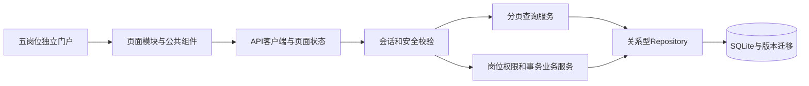

# 3.1架构与业务边界

更新日期：2026-10-19。当前实现保持原生浏览器模块、Node.js内置HTTP及SQLite，按职责组织代码。

## 请求与数据流

`public/app.js` 只安装入口和事件。页面、组件与API分离；路由、筛选、分页触发相应查询，保留导航及用户菜单，只更新业务主区。日/周日历按时间窗口分批读取完整结果，列表使用分页；预约与改期另有独立分页时段选择器。各页所需的关联实体由服务端批量补充。

样式源分为base、components、layout、staff、customer、auth、responsive、accessibility、print，通过明确的CSS layer顺序构建。重复规则由PostCSS/cssnano整理；普通主题不再依赖!important，减少动态及打印保留必要覆盖。

## 服务职责

| 模块 | 职责 |
|---|---|
| HTTP | JSON请求、Origin/Host、会话、CSRF、限流、幂等、静态资源 |
| policies | 顾客/前台/医生/店长/总部权限矩阵 |
| patients / patient-merge | 档案、身份核验、可追溯归并 |
| resources / appointments | 门诊资源、排班、预约和状态转换 |
| clinical / clinical-addenda | 治疗快照、完成冻结、追加附记 |
| finance / reports | 收退款、余额、冲销、日结与季度核算 |
| accounts | 创建、归属、在职状态、改密及核验恢复 |
| workspace | 按页SQL查询、关联补充、范围控制、聚合统计 |
| repositories | 白名单字段、SQL参数绑定、批量子表读写 |
| migrations | 版本、checksum、升级快照、事务和外键检查 |

医生可读其授权患者的跨门诊历史，预约列表及临床写入仍按本人责任控制。前台和店长按明确的clinicIds操作授权门诊；总部覆盖全部门诊。权限和数据范围在后端执行。

## 连锁职责与数据范围

| 岗位 | 数据范围 | 主要职责 |
|---|---|---|
| 顾客 | 本人档案与业务 | 注册、预约、自助改期取消、就诊及费用查看 |
| 前台 | 授权门诊 | 核对患者、预约与出席、排班、开单收款、营业日核对 |
| 医生 | 本人接诊及相关患者历史 | 记录治疗、完成诊疗、追加更正附记 |
| 店长 | 明确分配的门诊 | 门店患者与接诊、排班、诊疗与附记、收退款及冲销、日结、成本登记审核和履约统计 |
| 总部 | 全部门诊 | 统一资源、全部员工授权、患者主档归并与账号绑定、全链季度核算批准、全局规则、审计和业务导出；可处理跨店业务 |

店长看不到总部账号管理、全链审计与系统设置页面，不可核算或批准全链报告；其成本、账务、患者关联与预约统计均由服务端限制门诊范围。隐藏按钮只是界面表现，直接调用接口仍须通过同样校验。

## 存储与一致性

38张物理表包含十二类核心对象、关系子表、身份与审计、迁移记录、账簿、恢复及幂等信息。核心业务表不再使用每实体一个data JSON字段。用户身份对象保留兼容data，并以同步列查询；审计、幂等响应及历史签名使用快照形式。

Repository提供get/find/query/count及批量关联映射。所有修改使用同步事务，嵌套调用使用savepoint；金额以整数分处理。版本冲突返回409。账簿、诊疗附记和审计以追加记录留痕，完成治疗和原结算快照不被后续修改覆盖。

同一逻辑写入的Idempotency-Key及财务操作键检查内容hash，在事务内保存结果；重放返回原结果，内容变化拒绝。恢复凭证只显示一次，不进入审计或幂等响应缓存。

## 升级与运行

旧JSON数据库在停止旧服务后先生成VACUUM快照，再在事务中重建类型列和关系行。升级检查外键，失败回滚。已应用迁移校验checksum，后续结构变化必须新增版本，不能修改旧脚本。运行中的库受PID锁约束。第三版迁移将旧版全门诊店长保留原ID、用户名及密码哈希转换为总部，并撤销受影响会话和未使用恢复码；新建店长必须分配门诊，不能以空范围获得全链权限。

服务仍为单实例SQLite设计，没有据此声称多主机写入或200并发。线上能力需目标部署和真实负载验收。Docker及备份侧车采用持久化卷，反向代理负责HTTPS；本轮已验证内容见验收记录。

## 范围说明

实现了可操作的门诊预约与运营业务。收款为人工核验后登记，恢复为机构核验后交付单次凭证；未声称银行或短信联调成功。完整临床记录、正式票据、医保等依赖另行确定业务边界和供应商接口。
