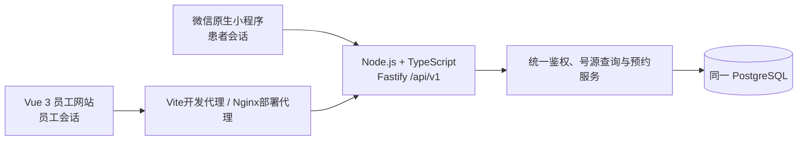

# 原生小程序与员工网站共用预约契约

审查日期：2026-10-23（Asia/Shanghai）。本次只读核对源码、SQL和已有验收记录，没有运行界面或改写业务数据。范围为门诊、医生、排班、号源与预约闭环。

## 1. 共用架构

- 小程序由 `miniprogram/src/config.ts` 指定唯一 API 地址，当前为 `http://127.0.0.1:3310/api/v1`，请求集中在 `utils/api.ts`。
- Vue 的 `admin-web/src/api.ts` 请求相对路径 `/api/v1`；开发时 `admin-web/vite.config.ts` 默认代理至同一 3310 服务，部署时 `deploy/booking/nginx.local.conf` 代理至 `api:3310`。
- `booking-api/src/main.ts` 将一份 `DATABASE_URL` 创建的 PostgreSQL 连接池传入 `createApp`。Compose 中 API 使用同一数据库配置。改变部署地址时，两端仍须指向同一套 API 环境。
- 共享 DTO 唯一手写来源为 `shared/src/index.ts`。Vue/API直接引用该包；小程序构建通过 `scripts/sync-contracts.mjs` 生成本地类型声明，未另行维护预约模型。
- 新端的调用路径不包含旧 `server/`、`public/` 或 SQLite。仓库仍保留旧版程序；根目录 `npm start` 启动旧服务，预约新端应使用 `npm run dev:api` 和 `npm run dev:admin`。旧版界面不属于本次跨端验收入口。

## 2. 七项要求逐项映射

| 要求 | 当前实现与主要源码证据 | 验收判定 |
| --- | --- | --- |
| 1. 小程序查询及预约、取消、改期 | `miniprogram/src/pages/booking` 查询门诊、医生、服务、号源并申请占位；`confirm` 确认；`appointments` 查询本人列表；`detail` 取消或进入改期。 | 源码具备完整调用链；实际微信页面操作须单独验收。 |
| 2. Vue维护资源、发布班次、管理预约 | `admin-web/src/views/ResourcesView.vue`、`ShiftsView.vue`、`AppointmentsView.vue`、`BookingView.vue` 分别调用资源、排班与预约API。 | 总部维护共享资料；店长维护授权门诊/牙椅和班次；前台管理授权预约；医生只读本人安排。并非每个员工都有全部维护权。 |
| 3. 共用 Node/TS API与PG | 上述网络入口归入 `booking-api/src/app.ts`；`src/db.ts` 只使用 `pg`。 | 新端之间没有第二套预约库或SQLite回退。运行时仍需核对两端地址，不能仅凭同名项目认定同环境。 |
| 4. 跨端状态同步 | 发布、占位、预约及变更均写同一库；两种列表读取同一 `appointments` 与 `resource_reservations`。 | Vue可见页每5秒自动重查列表及打开的详情，恢复可见立即重查；小程序进入列表或刷新时重查。无WebSocket推送。 |
| 5. 后端统一规则 | `services/resources.ts`、`services/booking.ts`、`repositories/booking.ts` 与数据库约束负责资格、容量、状态、并发和事务。 | 前端只做输入提示、筛选展示、确认及倒计时。即使绕过按钮，后端仍应拒绝非法请求。 |
| 6. 两端适当登录、统一权限 | 小程序登录提交 `portal: patient`；Vue提交 `portal: staff`。`auth.ts` 创建独立会话，每个请求重新加载有效用户与岗位范围。 | 患者仅操作本人；员工按角色与门诊授权；登录入口本身不替代API鉴权。当前为账号密码登录，微信身份授权接口尚未配置。 |
| 7. 优先真实预约联动 | 新API只实现预约相关状态，预约到诊状态仍为 `not_recorded`；参考价只读展示，与咨询预约费用分开。 | 不将支付、收款、财务或真实诊疗执行列作本次已实现功能。 |

## 3. 两端必须保持一致的接口

下表路径统一加 `/api/v1`；成功响应为 `{ data, requestId }`，错误为 `{ error, requestId }`。

| 环节 | 接口 | 统一约定 |
| --- | --- | --- |
| 员工发布班次 | `POST /staff/shifts` | 总部/授权店长提交门诊、医生、起止时间和服务ID；后端校验资格与重叠，提交后才开放号源。 |
| 查询号源 | `GET /booking-slots` | `clinicId/serviceId/date/doctorId?`；返回服务端生成的候选，不接受客户端自行计算的容量。查询不会占位。 |
| 短时占位 | `POST /booking-holds` | 平铺 `SlotSelection`，员工代约另传实际 `patientId`；患者身份来自会话。返回 `id/rowVersion/expiresAt/slot/policy`。 |
| 正式确认 | `POST /appointments/confirm` | `holdId/holdVersion/patientConfirmed:true/rulesAccepted:true`，员工可附核对的患者ID；必须有稳定 `Idempotency-Key`。 |
| 读取同一记录 | `GET /appointments`、`GET /staff/appointments`、`GET /appointments/:id` | 两种列表按身份过滤；详情使用相同预约ID。列表分页，详情含变更事件。 |
| 取消或改期 | `POST /appointments/:id/changes` | `intent/expectedVersion/reason`；改期另带 `holdId/holdVersion`。使用原操作的稳定幂等键。 |
| 结果不明恢复 | `GET /commands/:key` | 仅当前用户自己的回执，并再次校验当前权限；`not_found` 不等于明确失败，保留原请求与键重试。 |

改期成功后，旧预约为 `rescheduled`，新预约为 `confirmed`，通过 `supersedesAppointmentId/replacementAppointmentId` 相互追溯。取消保留原预约和原因，不删除历史。

## 4. 服务端保证及前端边界

1. **身份与范围**：`auth.ts` 校验不透明会话令牌和有效期，每次请求读取当前角色。`appointmentAccess` 将患者限制为本人，医生限制为本人就诊安排；仅有医生角色而缺失员工关联时，排班与预约列表直接403拒绝，不能以空关联放宽查询。总部、店长、前台按对应写权限和门诊范围处理预约。普通员工检索患者需输入完整姓名或电话，不能无条件枚举患者目录。
2. **资源可用性**：`querySlots` 统一核对活动门诊/医生/服务/牙椅、已发布班次、门诊项目、班次项目、所需资格全部满足及覆盖完整服务和缓冲时长、牙椅停用区间、其他有效占用。资格和资源在确认时再次核对，展示过号源不代表一定能预约。
3. **并发与事务**：`resource_reservations` 同时记录占位与正式预约，医生、牙椅、患者各有排斥约束；占用采用左闭右开区间。患者、医生、牙椅按固定顺序锁定；数据库外键与延迟约束校验占位、预约和资源归属。确认、事件、审计和回执在同一事务提交。
4. **取消与改期**：后端校验版本、有效状态及预约接受的取消时限快照。改期在同一事务释放旧资源、消费新占位并建立替代关系；目标不可用或数据库失败时全部回滚。客户端不能先取消旧预约再另建一笔来模拟改期。
5. **幂等与故障恢复**：幂等键按用户隔离；同键同内容返回原回执，同键不同内容拒绝。原生端和Vue都在发送前保存操作，不因超时或页面重开生成新键重复提交。回执恢复仍受当前权限控制。
6. **时间与页面状态**：数据库保存带时区时间，业务日期按 `Asia/Shanghai` 解释。倒计时、格式校验、资料完整提示、按钮禁用和列表筛选属于交互辅助；真正生效的时限、资格和容量均由服务端复核。

对应约束见 `database/migrations/001_booking_core.sql`，规则快照见 `002_policy_snapshots.sql`；事务入口见 `booking-api/src/db.ts`。本次审查没有发现需要另外建立前端规则副本的理由，也未发现新的后端安全阻塞。

## 5. 跨端闭环验收定义

使用独立的合成患者与未来班次，记录 `clinicId/doctorId/serviceId/shiftId`、每笔预约ID/预约号及改期前后ID。不得仅以页面“操作成功”提示作为依据。

| 步骤 | 通过条件 |
| --- | --- |
| 网站发布 → 小程序查询 | 授权员工在Vue发布班次后，小程序重新查询对应门诊、医生、日期及服务，返回含该 `shiftId` 的可约时段。 |
| 小程序预约 → 网站查询 | 原生端完成占位及确认后，Vue刷新得到相同 `id/appointmentNo`，身份、医生、项目与时间一致；PG中只生成一笔正式预约。 |
| 小程序取消 → 网站同步 | Vue刷新后原预约为 `cancelled`，原因及事件保留；重新查询号源可再次分配原资源。 |
| 小程序改期 → 网站同步 | 原预约为 `rescheduled`，替代预约为 `confirmed`；两端的新旧ID关联一致，旧时段释放、新时段唯一占用。 |
| 失败与权限 | 并发抢占最多一笔成功；失效占位、过期/缺失资格、过期版本及越权请求被后端拒绝；改期失败仍保留原预约和旧资源。 |
| 结果不明与重开 | 响应丢失后保留原操作；重开后用同键查询或重试，得到同一笔预约，不新增重复记录。 |

刷新约定：小程序预约列表在 `onShow`、下拉或主动刷新时重查。Vue可见页每5秒串行轮询列表及已打开详情，恢复可见立即重查，隐藏时暂停、离开页面时清理；进入、筛选、手动刷新和本端操作也重查。取消原因弹窗打开时暂停自动更新，不重置用户输入。请求序号与账号检查阻止旧响应覆盖新结果；网络失败明确提示同步暂未完成。此机制是轮询，没有实时推送。

小程序的确认、改期、取消分别显示对应结果。成功提示来自实际命令响应或已完成回执，绑定账号和会话；链接参数不能伪造成功。后续详情读取失败时保留已确认安排、提示重新读取并暂停变更；命令结果不明仍使用原键核对，不能显示成功。

## 6. 已有证据与未覆盖边界

本表为审查时读取的历史验收记录，非本次重新执行测试。后续新增联调记录应保留真实执行方式与时间，不能把HTTP适配器当作微信界面执行。

| 记录 | 已支持的结论 | 不能据此推断 |
| --- | --- | --- |
| `qa/api-integration.json`（2026-10-23，43/43） | 真实PG隔离库中30项预约规则及13项演示数据测试通过，涵盖权限、并发、幂等、原子改期、资格变更和时限快照。 | 微信/Vue已完成所有界面交互。 |
| `qa/browser.json`（2026-10-23，12项） | 真实Vue浏览器发布班次、读取患者HTTP预约、代约、取消、改期与结果恢复通过。 | 患者步骤是在真实微信运行时完成。 |
| `../../miniprogram/qa/native-api-smoke.json`（2026-10-23，20项） | 编译后的原生模块借助 `wx.request` 到 `fetch` 适配器访问真实HTTP和PG，预约规则与两端API同源通过。 | 微信开发者工具编译、WXML渲染、真机或微信身份授权已通过。 |
| `../../miniprogram/qa/client-unit.json`（2026-10-23，20/20） | 编译原生模块的模拟wx测试通过，包括账号切换、待确认操作、联动筛选和资料只读字段。 | 真实微信页面已点击验收。 |
| `qa/persistence.json`（2026-10-22） | PG真实重启前后数据摘要一致，API重启后读取同一预约。 | 容器部署、HTTPS或真机环境已验收。 |
| `qa/wechat-devtools.json`（早期记录，2026-10-23 04:42 UTC） | 当时工具报告服务端口关闭，记录为 `not_completed`。 | 不能代表后续工具状态，也不能记为原生界面闭环通过；应以随后完成的真实微信验收记录为准。 |

后续实测已完成“Vue发布 → 微信运行时查询并预约 → Vue查看 → 微信改期/取消 → Vue显示”的完整链路，使用 `D:\AndrewDentalMiniProgram` 和官方SDK，结果以 `qa/cross-client.json` 为准。上表历史记录保留其原日期与范围。真机和HTTPS仍需单独验收；当前回环地址仅适用于本机，微信身份授权尚未配置。

本轮补充记录：`qa/collaboration-api.json` 为45项真实PG回归，`qa/collaboration-admin.json` 为14项受控异步测试，`qa/doctor-view.json` 为7项真实Chrome医生只读验收。医生视图使用已有非空本人班次及预约核验，未为检查写入新的业务记录。
